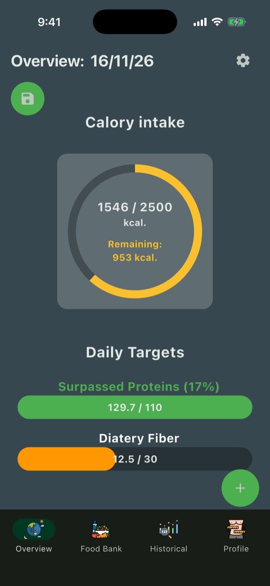
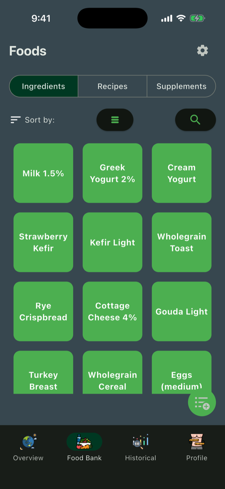
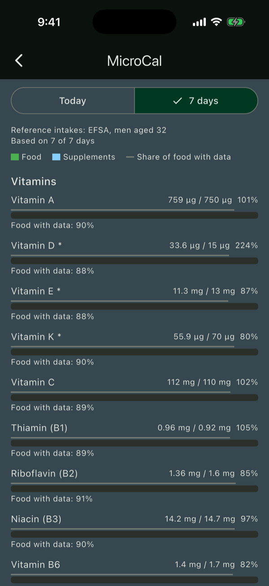
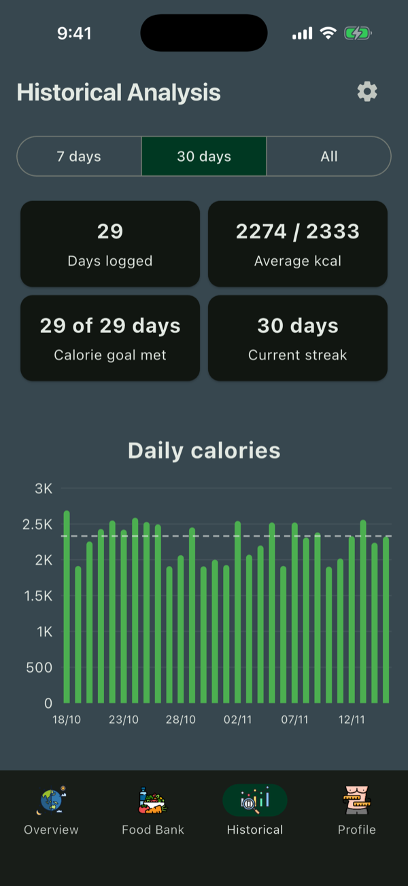

<div align="center">

# MacroCal

**A private, offline-first food log for calories, macronutrients and micronutrients.**

[](https://flutter.dev)
[](https://dart.dev)
[](#getting-started)
[](LICENSE)

[**Try the web version**](https://athanasiospapazoglou.github.io/MacroCal/) · [Features](#features) · [Getting started](#getting-started) · [Legal notice](#legal-notice)

</div>

> [!IMPORTANT]
> MacroCal is a personal food log for **general information only**. It is **not a medical device** and does not provide medical, dietary or nutritional advice, diagnosis or treatment. Read the full [Legal notice](#legal-notice) before use.

## Screenshots

<div align="center">

| Overview | Food Bank | MicroCal | History |
|:---:|:---:|:---:|:---:|
|  |  |  |  |

<sub>Screenshots show sample data on an iPhone simulator.</sub>

</div>

## Features

| | |
|---|---|
| **Profile and targets** | Enter your own daily targets for calories, protein and fibre and limits for sugars, saturated fat and salt, together with optional body details. |
| **Food Bank** | Keep the ingredients you eat, add new ones by hand or look them up by barcode on Open Food Facts. |
| **Recipes** | Combine ingredients into a dish, with the grams of each and an optional cooked weight, and log it by the grams you eat. |
| **Daily log** | Log what you eat in grams and see calories, protein, carbohydrates, sugars, fat, saturated fat, fibre and salt against the targets you set. |
| **Activity** | Record activities to add their estimated energy to the day's calorie target. |
| **MicroCal** *(optional)* | Log 21 vitamins and minerals from food and supplements and compare them with published adult population reference values (EFSA, or EU label values when sex or age are not set). It also shows how much of the logged food has micronutrient data. |
| **History** | Archive a day, then browse the last 7 days, 30 days or all time: averages, days within your targets, a daily calories chart, macro split, logging streak and each day in detail. |
| **Languages** | English and Greek. |
| **Privacy** | No account, no tracking, no ads. Your log stays on your device. |

## Privacy

- All data (profile, foods, logs and history) is stored **locally** in an on-device SQLite database, or in the browser's storage for the web version.
- MacroCal has no user accounts, analytics, advertising or tracking.
- The only network request is the optional barcode lookup, which sends the scanned barcode to [Open Food Facts](https://world.openfoodfacts.org). Their [privacy policy](https://world.openfoodfacts.org/privacy) applies to that request.
- Uninstalling the app, or clearing the site data in the browser, deletes your data permanently. There is no cloud backup.

## Getting started

### Requirements

- [Flutter](https://docs.flutter.dev/get-started/install) 3.47 or newer (includes Dart 3.13 or newer)
- For iOS: macOS with Xcode and CocoaPods
- For Android: Android Studio with the Android SDK and an emulator or device

### Run it

```bash
git clone https://github.com/AthanasiosPapazoglou/MacroCal.git
```

```bash
cd MacroCal && flutter pub get
```

```bash
flutter run
```

Generated code is committed, so a fresh checkout runs without a code generation step. Use `flutter devices` to choose a target, for example `flutter run -d chrome`.

## Using MacroCal

1. **Set your targets** on the Profile tab. MacroCal does not calculate targets for you; enter values you have chosen or agreed with a qualified professional.
2. **Fill the Food Bank** with ingredients, recipes and, if you use MicroCal, supplements.
3. **Log your day** from the Overview with the + button: grams of ingredients or recipes, units of supplements and any activities.
4. **Turn on MicroCal** in Settings if you want to log micronutrients. Add your sex and birth year in the profile to compare with EFSA adult values. MicroCal is for adults only.
5. **Archive the day** with the save button on the Overview. Archiving is manual: only archived days appear in the History.
6. **Review your history** on the History tab and tap a day to see its details or delete it.

## Architecture

MacroCal uses a feature-first clean architecture with [bloc](https://bloclibrary.dev) cubits for state and [drift](https://drift.simonbinder.eu) (SQLite) for storage.

```
lib/
├── main.dart            # calls bootstrap()
├── bootstrap.dart       # composition root: database, repositories, use cases → App
├── app/                 # App widget, router (go_router), theme, tab shell
├── core/                # database, l10n, shared widgets, asset paths, plain-Dart helpers
└── features/
    ├── settings/        # language, micronutrient tracking switch
    ├── profile/         # daily targets and body details
    ├── food_bank/       # ingredients, recipes, supplements, barcode lookup, reference foods
    ├── today/           # overview, consumption, activities, archive day
    ├── microcal/        # micronutrient intake, reference values, MicroCal page and card
    └── history/         # archived days, statistics, charts, day detail
        ├── domain/      # entities, repository interfaces, services; plain Dart only
        ├── data/        # drift and http implementations of the repositories
        └── presentation/# cubits, pages, widgets
```

- **Dependencies point inward:** `presentation → domain ← data`. Domain code imports no Flutter, drift or http; `test/architecture_test.dart` enforces this.
- **Drift is the single source of truth.** Repositories expose streams, so every screen watching the same data updates on its own.
- **Cubits never call other cubits or use a `BuildContext`**, and widgets never call repositories directly.
- **A feature's `data/` layer never imports another feature's `data/` layer.**
- **`XPage` provides the cubit and `XView` builds the UI.** Only `LocaleCubit` and `OverviewCubit` live app-wide.

## Development

| Task | Command |
|---|---|
| Static analysis | `flutter analyze` |
| Unit, widget and migration tests | `flutter test` |
| End-to-end tests (iOS simulator or macOS) | `flutter test integration_test -d <device id>` |
| Regenerate drift, freezed and JSON code | `dart run build_runner build` |
| Regenerate translations | `flutter gen-l10n` |

- Commit the output of `build_runner` after changing a drift table, a freezed class or a JSON DTO.
- Every new string goes in both `lib/core/l10n/arb/app_en.arb` and `app_el.arb`.
- A table change bumps `schemaVersion` in `app_database.dart`, runs `dart run drift_dev make-migrations`, and adds a step-by-step migration with its test in `test/drift/`.

### Adding a feature

1. Create `lib/features/<name>/{domain,data,presentation}`.
2. Add any tables in `lib/core/database/tables` with a migration, as above.
3. Add the repository interface (domain), its drift implementation (data), and the cubit, page and view (presentation).
4. Register the repository in `bootstrap.dart` and `App`, add the route in `lib/app/router`, and add the strings to both ARB files.
5. Add tests that mirror each layer under `test/features/<name>/`.

## Contributing

Contributions are welcome.

1. Fork the repository and create a branch: `git checkout -b feature/your-feature`.
2. Make your change with tests, and run `flutter analyze` and `flutter test`.
3. Open a pull request that describes the change.

Contributions must not add health, nutrition or medical claims to the app or its documentation (see [Legal notice](#legal-notice)). By contributing you agree that your contribution is licensed under the MIT License.

## Data sources and attribution

- **Reference foods** (`assets/data/reference_foods.json`): a selection of 696 foods from the ANSES-CIQUAL 2025 French food composition table, Anses, updated 19 November 2025, <https://doi.org/10.57745/RDMHWY>, used under the [Licence Ouverte / Open Licence 2.0](https://www.etalab.gouv.fr/licence-ouverte-open-licence/) (Etalab). Values are rounded to 4 significant digits; vitamin A is in retinol equivalents, folate in dietary folate equivalents where given, niacin as preformed niacin, vitamin K as K1 plus K2. Energy missing from the table is computed with the EU Regulation 1169/2011 factors. The Greek names are MacroCal's translations. The same values fill the micronutrients of the generic seed ingredients. Anses has not reviewed or endorsed MacroCal.
- **Reference values:** EFSA Dietary Reference Values for adults and EFSA's 2024 summary of tolerable upper intake levels; NASEM Dietary Reference Intakes only where EFSA set no value (upper levels for vitamin C, phosphorus, iron and manganese); the EU nutrient reference values for labelling (Regulation (EU) No 1169/2011, Annex XIII) while sex or birth year is missing. Pregnancy and lactation are not covered.
- **Barcode lookup:** [Open Food Facts](https://world.openfoodfacts.org), a collaborative database available under the [Open Database License](https://opendatacommons.org/licenses/odbl/1-0/). Its data is contributed by volunteers and may be incomplete or wrong.

## Legal notice

By installing, accessing or using MacroCal (the "App"), including its web version, you agree to this notice. If you do not agree, do not use the App.

### Not medical advice

The App and its content, including all numbers, charts, reference values, descriptions and other material, are provided for **general informational purposes only**. They are not, and are not intended to be, medical, dietary, nutritional or other professional advice, and they are not a substitute for advice, diagnosis or treatment from a physician, registered dietitian or other qualified healthcare professional.

- Always seek the advice of a qualified healthcare professional before making changes to your diet, physical activity or use of dietary supplements, and with any question you may have about a medical condition.
- Never disregard professional advice or delay seeking it because of something you have seen in the App.
- **In a medical emergency, contact your local emergency services immediately.**

### Not a medical device

The App is not intended for the diagnosis, prevention, monitoring, prediction, prognosis, treatment or alleviation of any disease, injury or other medical condition. It is not a medical device within the meaning of Regulation (EU) 2017/745 on medical devices, Section 201(h) of the US Federal Food, Drug, and Cosmetic Act, or any similar law, and it has not been evaluated, cleared or approved by any regulatory authority. The App does not interpret your data clinically: it records what you enter and displays it next to targets you set or published population reference values.

### No health or nutrition claims

The App makes no nutrition or health claims within the meaning of Regulation (EC) No 1924/2006 or any similar law, and nothing in the App or this repository should be read as a claim that any food, supplement, nutrient amount or behaviour will maintain or improve health or reduce the risk of any disease.

The micronutrient reference values come from public bodies (EFSA, NASEM and EU labelling law). They describe **average needs of healthy adult populations**. They are not personal recommendations, prescriptions or safe limits for you, and they do not account for pregnancy, breastfeeding, illness, medication, allergies, intolerances, age under 18 or any other individual circumstance. Calorie and macronutrient targets in the App are entered by you; the App does not calculate or recommend them.

### Who should not rely on the App

Do not rely on the App, and consult a qualified healthcare professional first, if you:

- are under 18 years of age;
- are pregnant, trying to become pregnant or breastfeeding;
- have, or have had, an eating disorder or a difficult relationship with food or body weight;
- have diabetes, kidney disease, a food allergy or any condition that requires a medical diet;
- take medication or supplements that interact with food or nutrients.

If tracking food causes you distress, stop using the App and speak to a healthcare professional.

### Accuracy of information

Food values come from users, from Open Food Facts (a volunteer-maintained database), from the ANSES-CIQUAL table and from product labels, and are processed through rounding and calculations. Values may be incomplete, outdated or wrong, and products vary. Activity energy figures are rough estimates. Results also depend on the accuracy of what you enter. Always check the label of the actual product and do not use the App to decide doses of supplements or medicines, or to manage any allergy.

### No warranty

The App is provided **"as is" and "as available"**, without warranty of any kind, express or implied, including but not limited to warranties of accuracy, completeness, reliability, merchantability, fitness for a particular purpose and non-infringement. The developers do not warrant that the App will be uninterrupted, error-free or free of data loss. You are responsible for keeping your own copies of any data you wish to keep.

### Limitation of liability

To the fullest extent permitted by applicable law, in no event shall the author, contributors or copyright holders be liable for any claim, damages, injury, loss or other liability, whether direct, indirect, incidental, special, consequential or exemplary, and whether in an action of contract, tort or otherwise, arising from, out of or in connection with the App or its use, including any decision you make or action you take based on information obtained from the App. Your use of the App is at your sole risk.

Nothing in this notice excludes or limits liability that cannot be excluded or limited under applicable law, including liability for death or personal injury caused by negligence, or for fraud, or your statutory rights as a consumer.

### Indemnity

To the extent permitted by applicable law, you agree to indemnify and hold harmless the author and contributors from any claims, damages, costs and expenses, including reasonable legal fees, arising from your use or misuse of the App or your breach of this notice.

### Third-party names and trademarks

EFSA, Anses, CIQUAL, NASEM, Open Food Facts and any product or brand names shown in the App are the property of their respective owners and are used only to identify sources or products. MacroCal is an independent open-source project and is not affiliated with, sponsored by or endorsed by any of them.

### Changes

This notice may be updated at any time by updating this file. The version in the repository's default branch applies.

## License

MacroCal is released under the [MIT License](LICENSE). Third-party data keeps its own licence as listed in [Data sources and attribution](#data-sources-and-attribution).

## Contact

Questions, bug reports and feature requests are welcome in [GitHub Issues](https://github.com/AthanasiosPapazoglou/MacroCal/issues). Please do not post personal health information in issues.
